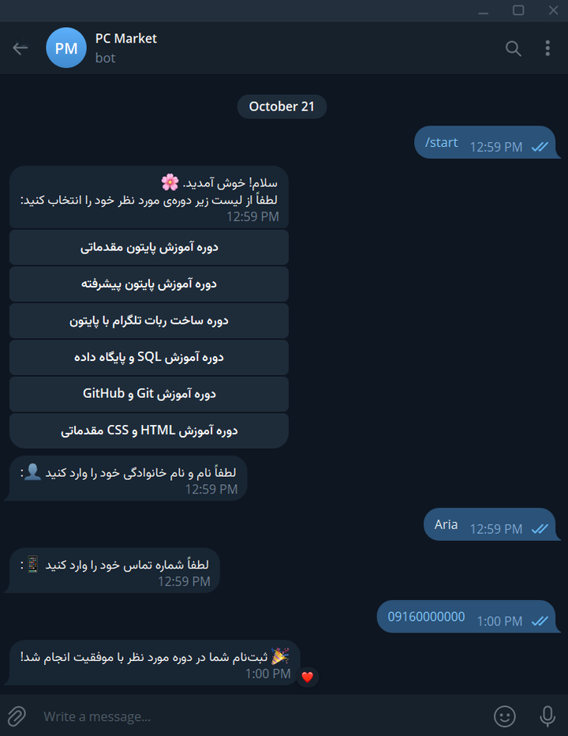

# 🎓 Academy Enrollment Bot

A Telegram bot that lets users browse courses and enroll through a guided, multi-step conversation. Enrollments respect course capacity, and a small admin panel gives course statistics. All data is stored in a relational SQLite database via SQLModel.

Built with **Python**, **pyTelegramBotAPI**, and **SQLModel**.

 TODO: add a screenshot or GIF, then uncomment (see "Screenshots" below).
<p align="center">
  
</p>


---

## Table of Contents

- [Features](#features)
- [Tech Stack](#tech-stack)
- [How It Works](#how-it-works)
- [Project Structure](#project-structure)
- [Database Schema](#database-schema)
- [Getting Started](#getting-started)
- [Usage](#usage)
- [Testing](#testing)
- [Design Notes](#design-notes)
- [Known Limitations](#known-limitations)
- [Roadmap](#roadmap)
- [Screenshots](#screenshots)
- [Author](#author)
- [License](#license)

---

## Features

- **Course catalog** presented as an inline keyboard, generated dynamically from the database
- **Guided enrollment flow** built on a finite state machine (FSM): course selection → full name → phone number
- **Capacity enforcement**: a full course rejects new enrollments (a course without a capacity is unlimited)
- **Input validation**: phone numbers must match `09XXXXXXXXX`. Persian and Arabic-Indic digits (`۰۹۱۲…`) are converted automatically, and spaces or hyphens are ignored
- **Duplicate protection**: a user cannot enroll in the same course twice
- **Returning-user handling**: existing users are reused instead of duplicated
- **Safe conversation flow**: a command typed in the middle of the flow (for example `/my_courses`) is never stored as a name or phone number
- **`/my_courses`**: lists every course the user is enrolled in
- **`/cancel`**: aborts the current flow at any step
- **Admin panel (`/admin`)**: overview statistics and per-course enrollment counts, restricted to the Telegram IDs listed in `ADMIN_IDS`
- **Configuration via environment variables**, with no secrets in the codebase

---

## Tech Stack

| Layer | Technology |
|-------|------------|
| Language | Python 3.14 |
| Bot framework | [pyTelegramBotAPI](https://github.com/eternnoir/pyTelegramBotAPI) (telebot), with its state-management API |
| ORM | [SQLModel](https://sqlmodel.tiangolo.com/) (SQLAlchemy + Pydantic) |
| Database | SQLite |
| Configuration | python-dotenv |
| Testing | pytest |
| Dependency management | uv (`pyproject.toml`, `uv.lock`) |

---

## How It Works

```
/start
  │
  ▼
Course list (inline keyboard)
  │  user taps a course
  ▼
State: full_name    ──►  "Enter your full name"
  │
  ▼
State: phone_number ──►  "Enter your phone number"
  │  digits normalized, then validated with ^09\d{9}$
  ▼
enroll_user(): already enrolled? ─► course full? ─► save user + enrollment
  │
  ▼
State cleared ──► result message
```

Conversation data (selected course, full name) lives in the FSM storage while the user moves through the steps, and is written to the database only after the final step succeeds.

---

## Project Structure

```
.
├── bot.py                     # Entry point: logging, handler registration, polling
├── loader.py                  # Bot instance, state storage, middleware, custom filters
├── config.py                  # Environment variables (BOT_TOKEN, DB_NAME, ADMIN_IDS)
├── phone.py                   # Phone normalization and validation
├── add_sample_course.py       # Seeds the database with sample courses
├── database/
│   ├── db.py                  # Engine, session factory, table creation
│   ├── models.py              # SQLModel models: User, Course, Enrollment
│   ├── enrollment.py          # Enrollment business logic (capacity, duplicates)
│   ├── admin_queries.py       # Read-only queries for the admin panel
│   └── keyboards/
│       └── inline.py          # Inline keyboard builders
├── handlers/
│   ├── admin_handlers.py      # /admin and its inline buttons
│   └── user_handlers.py       # Command, callback and FSM step handlers
├── test_database.py           # Database tests
├── test_validators.py         # Input validation tests
├── test_phone.py              # Phone normalization tests
├── test_enrollment.py         # Enrollment and capacity tests
├── test_admin_queries.py      # Admin statistics tests
├── .env.example
├── pyproject.toml
└── uv.lock
```

`loader.py` exists as a separate module so that `bot.py` and the handlers can share one bot instance without circular imports. The business logic in `database/enrollment.py` and `database/admin_queries.py` takes a database session as a parameter, so it can be tested without Telegram.

---

## Database Schema

```
┌───────────────┐        ┌──────────────────┐        ┌───────────────┐
│     users     │        │   enrollments    │        │    courses    │
├───────────────┤        ├──────────────────┤        ├───────────────┤
│ id (PK)       │◄──┐    │ id (PK)          │    ┌──►│ id (PK)       │
│ telegram_id   │   └────│ user_id (FK)     │    │   │ title         │
│ full_name     │        │ course_id (FK)   │────┘   │ description   │
│ phone         │        │ enrolled_at      │        │ price         │
│ joined_at     │        └──────────────────┘        │ capacity      │
└───────────────┘                                    └───────────────┘
```

`enrollments` is a join table that models the many-to-many relationship between users and courses. A `capacity` of `NULL` means the course has no limit.

---

## Getting Started

### Prerequisites

- Python 3.14 or newer (see `requires-python` in `pyproject.toml`)
- A Telegram bot token from [@BotFather](https://t.me/BotFather)
- [uv](https://docs.astral.sh/uv/) (recommended) or pip

### 1. Clone the repository

```bash
git clone https://github.com/Aria868616/academy-enrollment-bot.git
cd academy-enrollment-bot
```

### 2. Install dependencies

With **uv**:

```bash
uv sync
```

Or with **pip**:

```bash
python -m venv .venv

# Windows
.venv\Scripts\activate
# macOS / Linux
source .venv/bin/activate

pip install "pyTelegramBotAPI>=4.37.0" sqlmodel python-dotenv pytest
```

### 3. Configure environment variables

Copy `.env.example` to `.env` and fill in the values:

```env
BOT_TOKEN=your_telegram_bot_token
DB_NAME=sqlite:///academy.db
ADMIN_IDS=123456789
```

| Variable | Required | Description |
|----------|----------|-------------|
| `BOT_TOKEN` | Yes | Bot token issued by BotFather |
| `DB_NAME` | No | SQLAlchemy database URL (default: `sqlite:///academy.db`) |
| `ADMIN_IDS` | No | Comma-separated numeric Telegram user IDs allowed to use `/admin`. If empty, the admin panel is disabled and a warning is logged at startup |

To find your numeric Telegram ID, message a bot such as [@userinfobot](https://t.me/userinfobot).

> Never commit your `.env` file. It is already listed in `.gitignore`.

### 4. Seed sample courses

```bash
uv run add_sample_course.py
```

### 5. Run the bot

```bash
uv run bot.py
```

On startup the bot creates any missing database tables, removes any leftover webhook, and begins long polling.

---

## Usage

| Command | Who | Description |
|---------|-----|-------------|
| `/start` | Everyone | Show the course list and begin enrollment |
| `/my_courses` | Everyone | List the courses you are enrolled in |
| `/cancel` | Everyone | Cancel the current enrollment process |
| `/admin` | Admins only | Open the admin panel (overview statistics, enrollments per course) |

Users who are not listed in `ADMIN_IDS` get the same reply to `/admin` as for any unknown message, so the panel's existence is not revealed.

---

## Testing

```bash
uv run pytest
```

The tests cover database operations, input validation, phone normalization, enrollment rules (duplicates, capacity, unknown course) and the admin statistics queries. The query and enrollment tests use an in-memory SQLite database, so they need neither a bot token nor a `.env` file.

The Telegram-facing parts (handler registration order, the admin filter, inline buttons) are verified manually in a real chat.

---

## Design Notes

- **Shared bot instance in `loader.py`.** Running `python bot.py` executes the file as `__main__`. If a handler module imported the bot from `bot.py`, the file would be loaded a second time under another name, producing two separate bot objects. Handlers would register on one while polling ran on the other, and the bot would silently ignore every message. Keeping bot creation in `loader.py` avoids this.
- **Handler registration order matters.** telebot checks handlers in the order they were registered, and the catch-all `fallback` handler matches every message. The admin handlers are therefore imported before the user handlers in `bot.py`, and `admin_handlers.py` must never import from `user_handlers.py`, which would register the fallback too early.
- **Business logic is separate from handlers.** `enroll_user()` and the admin queries receive a `Session` and return plain results (an `EnrollmentResult` enum, named tuples). This keeps the Telegram code thin and makes the rules testable with an in-memory database.
- **Capacity check and insert run under a lock.** Telebot handles messages in threads, so `enroll_user()` holds a `threading.Lock` around "count enrollments, then insert". A user who is already enrolled is told so even if the course has since filled up, and a rejected user is not created in the database.
- **Phone input is normalized before validation.** Persian and Arabic-Indic digits are converted to ASCII, and the pattern is compiled with `re.ASCII`. Without it, `\d` also matches non-ASCII digits, which would let mixed-script numbers into the database.
- **Commands are ignored by the FSM step handlers.** The name and phone handlers only accept plain text (not starting with `/`), so a command typed mid-flow reaches its own handler and the conversation state stays intact.
- **State is set before data is stored.** With the library version used here, calling `state.set()` on a user who has no active state clears any data stored just before it. This was observed in debug logs and has not been confirmed in the library's source. The course-selection handler therefore sets the state first and stores the selected course afterwards.
- **FSM state and database state are kept separate.** Temporary conversation data stays in the FSM storage. The database is written only once the user has completed every step.
- **Configuration is centralized.** All environment access happens in `config.py`, and the app fails fast with a clear error if the bot token is missing.

---

## Known Limitations

- **FSM state is kept in memory** (`StateMemoryStorage`). A restart discards conversations that are in progress.
- **The capacity lock only works inside one process.** Running several bot instances at once, or switching to a shared database, would need a database-level mechanism.
- **Capacity is checked at the end of the flow.** A user can type their name and phone before learning that the course is full.
- **Duplicate enrollments are prevented in application code only.** There is no unique constraint on `(user_id, course_id)` in the database.
- **Returning users keep their stored name and phone.** Details entered in a later enrollment are not used to update them.
- **The admin panel is read-only.** Courses are added with `add_sample_course.py` or directly in the database.
- **Long polling only.** There is no webhook setup, Dockerfile or hosted deployment yet.

---

## Roadmap

- [x] Enforce course `capacity` during enrollment
- [x] Admin panel, phase 1: statistics
- [ ] Admin panel, phase 2: add and remove courses, broadcast messages
- [ ] Check capacity as soon as a course is selected (or hide full courses)
- [ ] Unique constraint on `(user_id, course_id)`
- [ ] Let users cancel an enrollment
- [ ] Persistent FSM storage (Redis or file-based) so conversations survive restarts
- [ ] Dockerfile and deployment instructions
- [ ] CI pipeline running tests on every push

---

## Screenshots

Add screenshots to `docs/screenshots/` and reference them at the top of this file. Suggested set:

1. Welcome message with the course list
2. Name and phone prompts
3. Successful enrollment, and the "course is full" reply
4. `/my_courses` output
5. Admin panel with the statistics view

Make sure screenshots do not reveal real phone numbers, chat lists or your bot token.

---

## Author

**Aria**

- GitHub: [@Aria868616](https://github.com/Aria868616)

---

## License

This project is licensed under the MIT License. See the [LICENSE](LICENSE) file for details.